# 臺北市夜間交通事故情境分群：期中報告

- 組別：第二組
- 撰寫與結果核對日期：2026-11-09
- 分析範圍：臺北市2025年死傷交通事故資料
- 本稿定位：以「不含月份的一般 one-hot 矩陣、K=5」呈現探索性情境，並以含月份、不同群數及類別區塊加權結果檢查敏感度。五群尚非最終定案。

> **目前發現：** 含月份時，群組主要反映季節、時段與速限；移除月份後，出現傍晚直路與交岔路的區分。凌晨型的照明問題與死亡事故比例較高，但各群受傷人數相近、整體地理區隔較弱。較細的五群對權重設定敏感，後續須在穩定性與情境細緻程度之間取捨。

## 1. 研究問題、資料與分析定位

### 1.1 研究問題

本研究希望回答：**臺北市夜間死傷交通事故，能否依時間、速限與道路環境，區分為可解釋的事故情境？這些情境的照明狀況、事故嚴重程度與地理組成是否不同？**

本研究先以 PCA 與 k-means 分群，再比較照明及傷亡。照明、死亡、受傷人數、行政區與座標都不放入分群，避免群組直接由要比較的結果決定，也避免分類只反映行政邊界。月份自本次主展示規格移除，保留作分群後描述及敏感度比較；天候仍是候選輸入。

分析對象只有已發生的死傷事故，因此產出是值得後續檢視的情境與地點線索，不能估計全市道路事故發生率，也不推論照明改善的因果效果。

### 1.2 資料來源與樣本

資料來自[臺北市資料大平臺的死傷交通事故資料](https://data.taipei/dataset/detail?id=2f238b4f-1b27-4085-93e9-d684ef0e2735)，使用民國114年（2025年）檔案，代碼說明見[事故對照表](../data/raw/事故對照表.pdf)。

**表1　從全年資料到分群主樣本**

| 篩選階段 | 件數 | 說明 |
| --- | ---: | --- |
| 全年事故紀錄 | 22,762 | 每列皆為第一當事人紀錄，暫以一列一事故 |
| 日出日落定義的夜間事故 | 6,795 | 依各筆日期與座標，以 Astral 3.2 計算；事故早於日出或晚於日落 |
| 排除關鍵道路類別欄位缺失 | −3 | 沿用既有處理規則 |
| 再排除速限為0的紀錄 | −91 | 官方意義待確認，不視為真實0 km/h |
| **分群主樣本** | **6,701** | 下文敘述統計、分群與群組比較均用此樣本 |

全年紀錄另有2筆日夜無法判定，未納入6,795筆夜間事故。日出日落夜間並不等於現場完全黑暗。資料沒有官方事故唯一識別碼，雖候選鍵無重複，事故觀察單位仍待進一步核對。

主樣本以 `record_id` 一對一連結道路、照明、傷亡、行政區及座標；本次使用的這些欄位均無缺值。除明列的篩選外，不另刪除主樣本中的低頻類別。

## 2. 月份、時間、行政區、道路型態、速限與天候的敘述性統計

**圖1　夜間事故月份分布（N=6,701）**

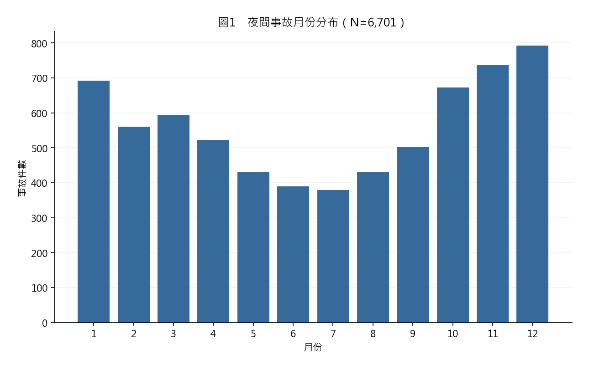

**圖2　夜間事故時段分布（N=6,701）**

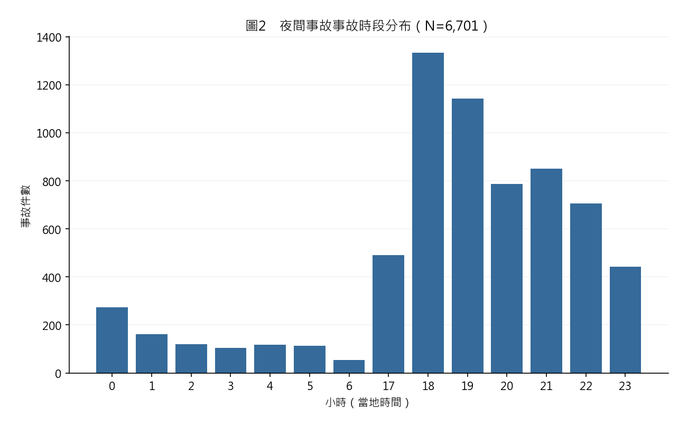

**圖3　夜間事故行政區分布（N=6,701）**

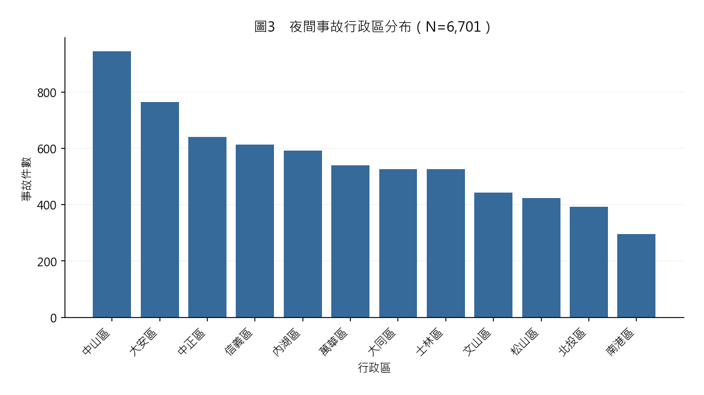

**圖4　夜間事故道路型態分布（N=6,701）**

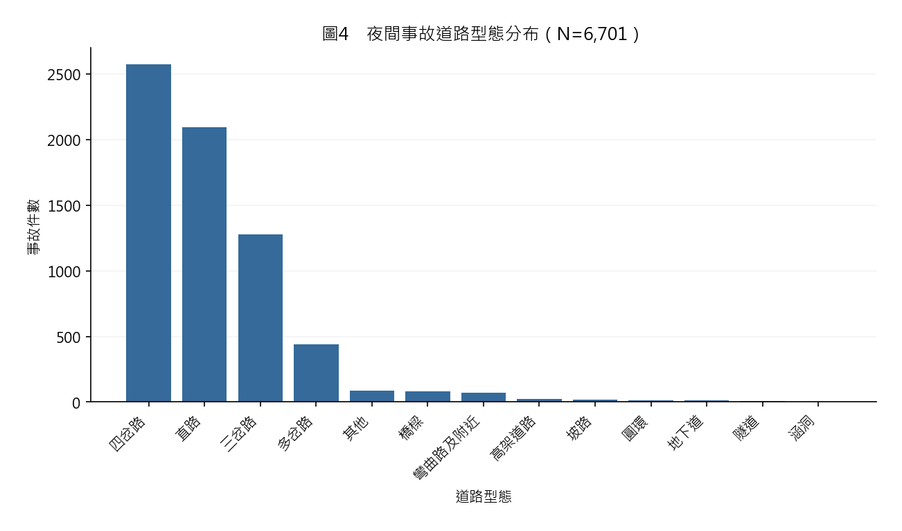

**圖5　夜間事故道路速限分布（N=6,701）**

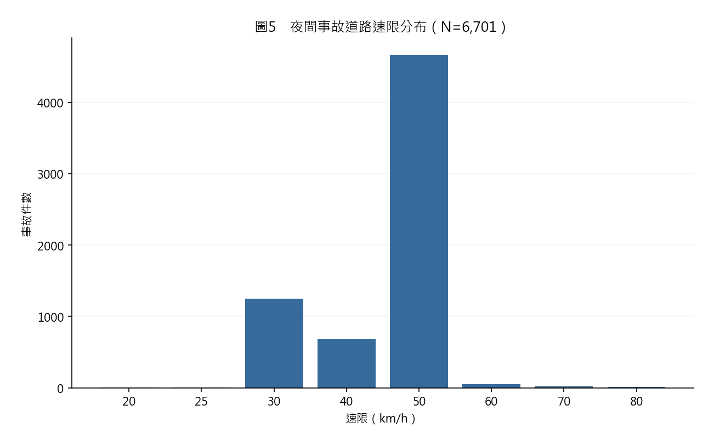

**圖6　夜間事故天候分布（N=6,701）**

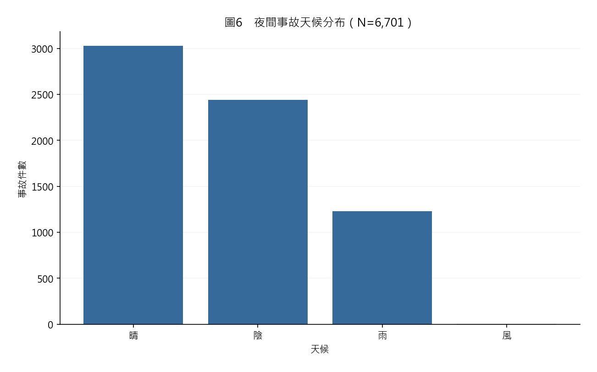

**表2　主樣本的主要分布（各項百分比分母均為6,701）**

| 變數 | 實際分布 | 對後續分析的意義 |
| --- | --- | --- |
| 月份 | 12月793件（11.83%）、11月737件（11.00%）；7月379件（5.66%）最少 | 夜間樣本較偏秋冬，但也可能反映季節性夜長與納入時段不同 |
| 發生時間 | 17～20時共3,757件（56.07%）；18時最多，1,335件（19.92%） | 應和傍晚下班尖峰車流量較大有關 |
| 行政區 | 中山區945件（14.10%）、大安區764件（11.40%）、中正區640件（9.55%） | 保留作分群後的區域組成比較 |
| 道路型態 | 四岔路2,571件（38.37%）、直路2,095件（31.26%）、三岔路1,275件（19.03%） | 可檢查時段相近的事故是否形成不同道路情境 |
| 道路速限 | 50 km/h：4,672件（69.72%）；30 km/h：1,253件（18.70%）；40 km/h：681件（10.16%） | 速限有明顯集中，須觀察低速限群是否穩定 |
| 天候 | 晴3,030件（45.22%）、陰2,441件（36.43%）、雨1,229件（18.34%）、風1件 | 有環境意義，但是否增加群組區辨力仍須檢查 |

上述分布都描述「已發生事故的組成」。沒有交通量、道路長度、各天候行車時間等分母，不能由件數判斷某行政區、月份或天候較危險。速限是道路規定，並非事故當下的實際車速。

## 3. 分群方法與暫以K=5展示的理由

### 3.1 特徵處理與模型流程

本次沿用既有處理資料，主規格使用：

- **數值與時間特徵：** 標準化速限，以及事故小時的 sin／cos 週期轉換。
- **類別特徵：** 天候、道路類別、道路型態及事故位置，使用 one-hot encoding；不把名目代碼直接當作連續數字。
- **分群後比較變數：** 月份、照明、死亡、受傷人數、行政區與座標。

移除月份的 sin／cos 後，模型由49個特徵變為47個；只改變特徵組，不改樣本與其餘編碼。一般矩陣的數值欄已標準化，dummy保留0／1；敏感度版本將每個類別變數的one-hot區塊除以該區塊類別數的平方根。

對兩種矩陣各自重做 PCA，保留累積解釋變異至少80%的最少主成分，再在 PCA scores 上比較 K=2～6。主要 k-means 使用固定種子5166、50次初始化；穩定性另比較10組種子，每組10次初始化。Silhouette以固定3,000件估計，Ward階層式分群以固定1,000件輔助，完整設定與結果保留於[本次執行Notebook](../finding/nighttime_no_month_midterm.ipynb)。

### 3.2 為何移除月份？

原本含月份的K=5形成秋冬傍晚、夏季晚間、春季晚間、深夜凌晨與低速限晚間等群組。前三群主要差在季節，道路組成相近，因此對辨識不同道路情境的額外幫助有限。

月份本身已投入分群，分完後發現月份不同，新增資訊有限；而且依日出日落界定夜間，冬季傍晚較容易被納入，季節群也可能部分反映取樣範圍。本次因此將月份移出主展示規格，觀察道路與時段能否形成更有解讀價值的區隔。這不表示季節與事故無關，月份仍保留作後續分層與描述。

**表3　PCA結果比較（各規格N=6,701）**

| 矩陣與特徵設定 | 特徵數 | 達80%門檻的主成分數 | 實際累積解釋變異 |
| --- | ---: | ---: | ---: |
| 一般矩陣，含月份 | 49 | 7 | 84.89% |
| **一般矩陣，不含月份** | **47** | **6** | **83.97%** |
| 區塊加權，含月份 | 49 | 4 | 86.80% |
| 區塊加權，不含月份 | 47 | 3 | 92.13% |

一般矩陣移除月份後，前兩個主成分主要反映時段與速限，道路型態及事故位置從原先第五主成分提前至第三主成分；第五主成分主要反映天候。因此道路特徵在保留的空間中較能參與區分。但區塊加權版只保留三個主成分，主要仍反映時段與速限，道路細分較弱。

### 3.3 群數比較：五群是探索性細分，不是唯一最優解

**圖7　移除月份後的分群分離度（N=6,701；固定抽樣3,000件估計）**

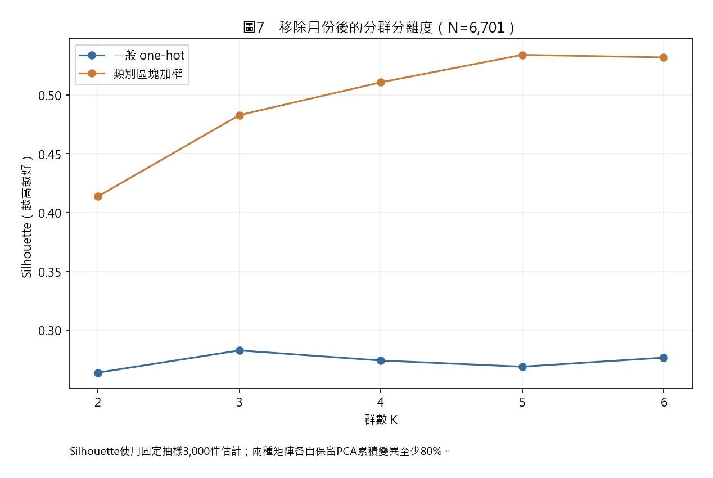

**圖8　不同初始化的分群穩定性（N=6,701）**

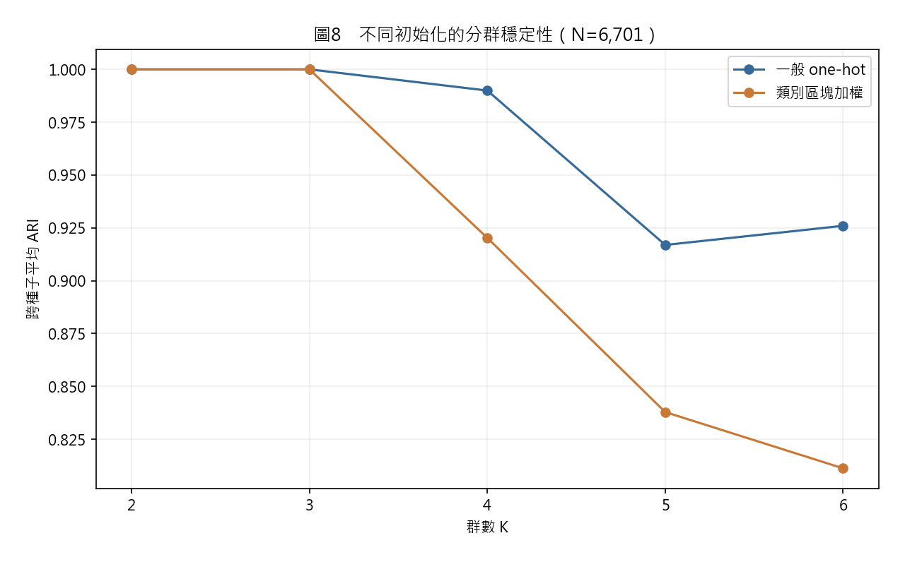

**圖9　一般與區塊加權分群的一致度（N=6,701）**

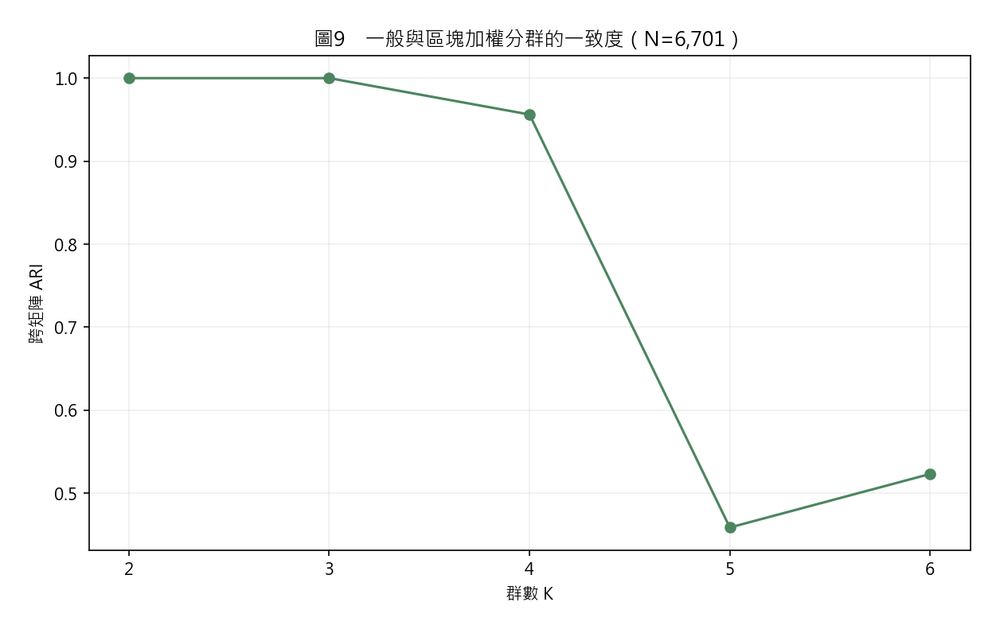

**表4　不含月份的一般矩陣群數比較（N=6,701）**

| K | Silhouette ↑ | Davies–Bouldin ↓ | 跨種子平均ARI ↑ | 一般與區塊加權ARI ↑ | 最小群件數 |
| ---: | ---: | ---: | ---: | ---: | ---: |
| 2 | 0.264 | 1.545 | 1.000 | 1.000 | 2,944 |
| **3** | **0.283** | 1.331 | **1.000** | **1.000** | 1,417 |
| 4 | 0.274 | 1.275 | 0.990 | 0.956 | 688 |
| **5** | **0.269** | **1.258** | **0.917** | **0.459** | **571** |
| 6 | 0.277 | 1.279 | 0.926 | 0.523 | 477 |

註：ARI衡量分群結果一致度，1表示兩組分群完全一致，與群號編排無關；它不是預測準確率。跨種子ARI與跨矩陣ARI分別回答初始化及權重敏感度，不能互相替代。

本次暫以五群展示，是因為它能在時段與速限之外，辨識出傍晚直路與交岔路的細分，且最小群仍有571件；一般矩陣的Davies–Bouldin也在五群最低。**這是可解釋性與穩健性的取捨，並非各項指標一致支持五群。**

三群的一般矩陣silhouette最高，跨種子與跨矩陣ARI皆為1，也獲一般矩陣的Ward抽樣分離度支持，是較穩定的基準。四群跨矩陣ARI為0.956，也值得對照。五群跨權重ARI降至0.459，表示直路／交岔路等細分尚依賴設定。

相較含月份的一般矩陣K=5，移除月份後silhouette由0.183升至0.269，但跨種子ARI由0.995降至0.917，跨矩陣ARI由0.843降至0.459。**移除變數也改變了距離定義，不能只因silhouette升高，就認定新版更好。** 照明與死亡比例沒有被用來挑選群數。

## 4. 初步五群結果與照明、傷亡、地理比較

### 4.1 五群各代表什麼情境？

**表5　不含月份的一般矩陣K=5群組輪廓（N=6,701）**

| 暫用群名 | 件數（占比） | 主要時段 | 速限：平均／中位數（km/h） | 主要道路特徵 |
| --- | ---: | --- | ---: | --- |
| 凌晨型 | 571（8.52%） | 凌晨2～5時合計約79.5% | 43.1／50 | 四岔路42.2%、直路27.0%、三岔路16.3% |
| 速限50晚間型 | 1,958（29.22%） | 21時至翌日0時合計約94.9% | 49.2／50 | 四岔路38.7%、直路31.5%、三岔路17.7% |
| 低速限型 | 1,183（17.65%） | 涵蓋不同夜間時段，18～20時約57.2% | 30.7／30 | 四岔路44.5%、三岔路24.9%、直路20.8% |
| 傍晚直路型 | 1,135（16.94%） | 幾乎皆在17～20時 | 48.8／50 | **95.1%為直路** |
| 傍晚交岔路型 | 1,854（27.67%） | 幾乎皆在17～20時 | 49.4／50 | **四岔路56.5%、三岔路29.2%、多岔路10.6%** |

群名是完成分群後的特徵摘要，不是預先設定的分類門檻，也不表示真實世界必然存在固定五類事故。

相較季節群，最有解讀價值的新區隔是傍晚直路與交岔路：兩群時段與速限相近，卻有不同道路型態，可用於後續比較照明設備與事故位置。原本三個季節群的事故重新分配到這些時段與道路情境，而不是把季節群直接改名。

天候目前沒有形成明確不同的群組：各群晴天比例都約45%，凌晨型雨天22.9%略高，其他群約17.1%～18.4%。因此天候仍保留為候選，尚未宣稱其有很強的區辨力，也尚未執行移除天候的敏感度。

### 4.2 照明狀況有差異嗎？

**表6　各群三種照明狀況（百分比分母為各群N；主樣本N=6,701）**

| 群組 | N | 有照明且開啟 | 未開啟／故障 | 無照明 | 後兩類合計 |
| --- | ---: | ---: | ---: | ---: | ---: |
| 凌晨型 | 571 | 87.04% | **9.28%** | **3.68%** | **12.96%** |
| 速限50晚間型 | 1,958 | 94.54% | 4.60% | 0.87% | 5.46% |
| 低速限型 | 1,183 | 93.07% | 5.41% | 1.52% | 6.93% |
| 傍晚直路型 | 1,135 | 92.60% | 5.99% | 1.41% | 7.40% |
| 傍晚交岔路型 | 1,854 | 94.17% | 4.48% | 1.35% | 5.83% |

註：個別比例與合計各自由未四捨五入值計算。未開啟與故障無法由原始代碼再拆分；「照明問題」僅是後兩類合計的操作性名稱，不代表已確認設備違規或事故原因。

凌晨型有74件屬後兩類，合計12.96%，95% Wilson信賴區間為10.45%～15.96%。群組與三分類照明的卡方檢定p<.001，但Cramér’s V僅0.061，屬很小的整體關聯。因此較有根據的說法是「凌晨型照明問題比例較突出」，而非五群照明環境截然不同。

### 4.3 事故嚴重程度有差異嗎？

**表7　各群傷亡結果（各群均無缺值；死亡指事故發生後24小時內）**

| 群組 | 死亡事故數／群組N | 死亡事故比例 | 死亡比例95% Wilson CI | 每件受傷人數：平均（SD） |
| --- | ---: | ---: | --- | ---: |
| 凌晨型 | 11／571 | **1.93%** | 1.08%～3.42% | 1.308（0.601） |
| 速限50晚間型 | 10／1,958 | 0.51% | 0.28%～0.94% | 1.366（0.617） |
| 低速限型 | 3／1,183 | 0.25% | 0.09%～0.74% | 1.351（0.568） |
| 傍晚直路型 | 1／1,135 | 0.09% | 0.02%～0.50% | 1.375（0.841） |
| 傍晚交岔路型 | 1／1,854 | 0.05% | 0.01%～0.30% | 1.337（0.577） |

凌晨型只占主樣本8.52%，卻包含26件24小時內死亡事故中的11件。因死亡事件稀少，整體死亡比例比較使用固定群組大小與死亡總數的條件Monte Carlo檢定（49,999次模擬，p<.001），不以稀疏表格的普通卡方近似作主要依據。

各群受傷人數中位數都是1人，Kruskal–Wallis分布檢定p=.300，未顯示明顯差異。不能因此宣稱各群傷勢一樣：**受傷人數衡量涉及多少傷者，不等於傷勢嚴重程度，目前也無可靠重傷指標。** 2～30日死亡另有2人，均在速限50晚間型，未併入表中的24小時死亡指標。

**圖10　各群照明問題比例及95%信賴區間（N=6,701）**

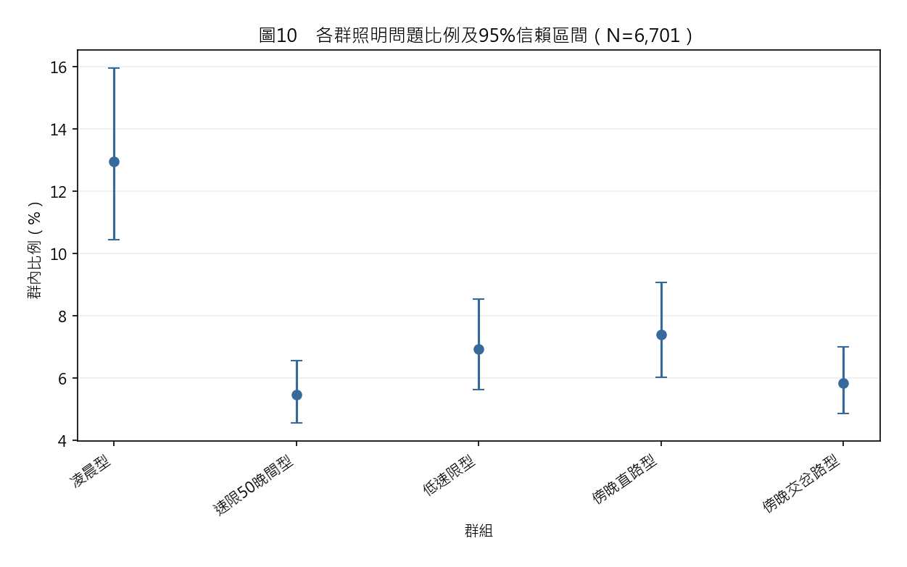

**圖11　各群24小時內死亡事故比例及95%信賴區間（N=6,701）**

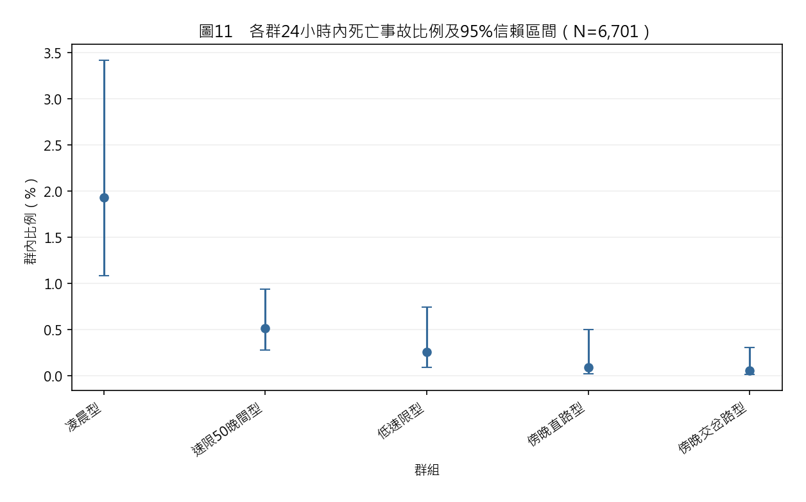

**圖12　各群每件平均受傷人數及95%信賴區間（N=6,701）**

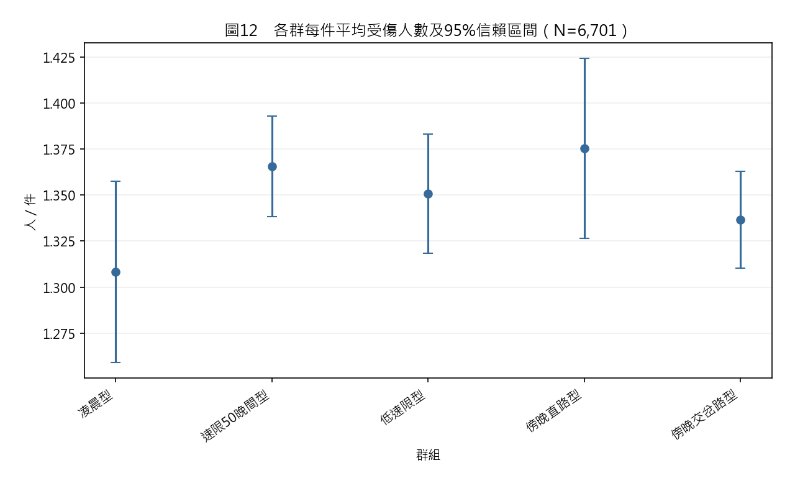

圖10～11的照明及死亡比例採Wilson區間；圖12的受傷均值採常態近似區間。這些區間及檢定以目前固定分群標籤計算，未納入重新分群的不確定性。所有檢定均為探索性，未做多重比較校正，也未處理可能的時間／地點群聚相關。描述性差異不能歸因於照明或時段造成死亡。

### 4.4 行政區與點位分布有差異嗎？

**表8　各群較值得注意的行政區組成（群內占比，非行政區事故率）**

| 群組 | 群內行政區組成 | 全部主樣本的對照 |
| --- | --- | --- |
| 凌晨型 | 萬華區14.7% | 全樣本萬華區8.1% |
| 速限50晚間型 | 中山區17.0% | 全樣本中山區14.1% |
| 低速限型 | 大安區13.9%、中山區8.3% | 全樣本分別11.4%、14.1% |
| 傍晚直路型 | 中山區16.7%、內湖區11.1% | 全樣本分別14.1%、8.8% |
| 傍晚交岔路型 | 中正區11.7% | 全樣本中正區9.6% |

行政區與群組的卡方檢定p<.001，但Cramér’s V僅0.089，整體關聯小。各群平均座標中心最大相距約0.96公里，只能說組成略有不同；平均中心接近也不能排除局部道路聚集。

圖13～17分別呈現五群事故點位，各圖共用相同座標範圍、點大小與透明度，方便跨圖比較。

**圖13　凌晨型事故點位（N=571）**

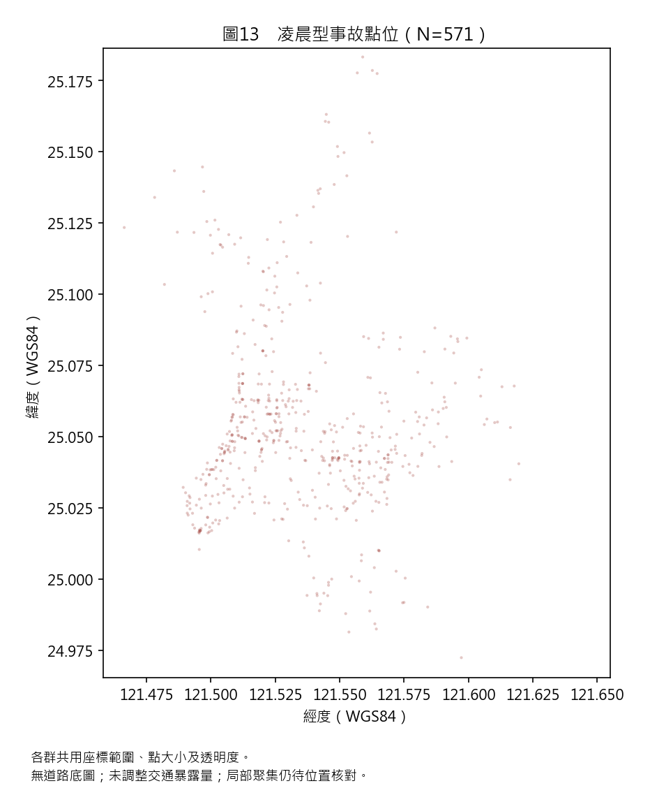

**圖14　速限50晚間型事故點位（N=1,958）**

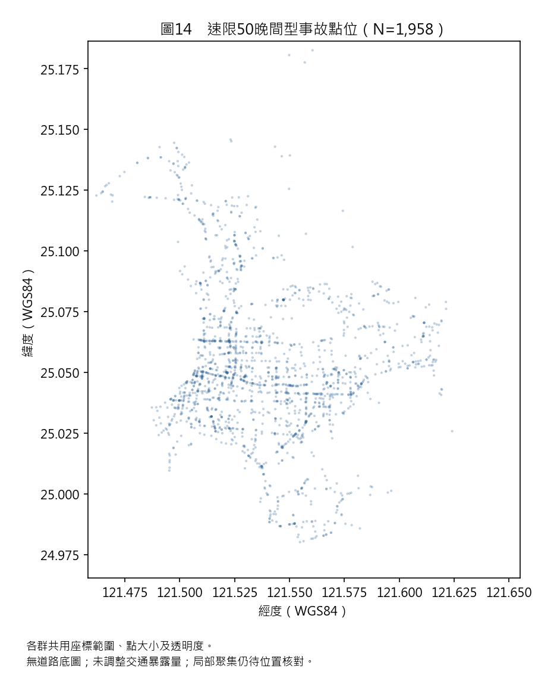

**圖15　低速限型事故點位（N=1,183）**

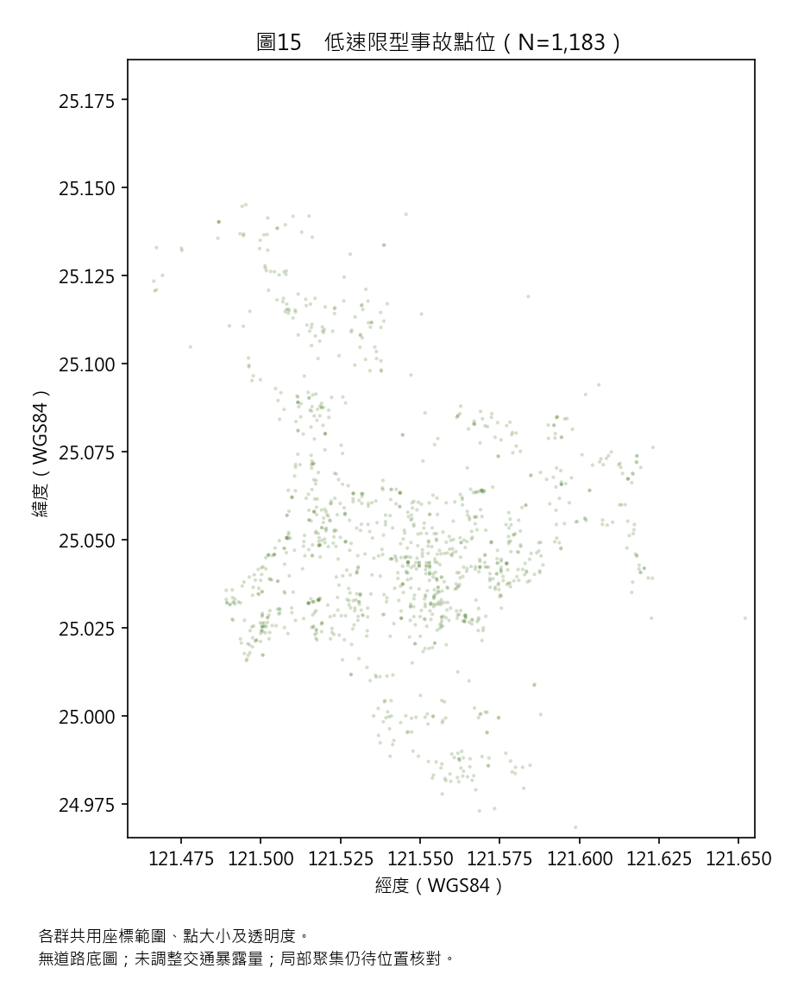

**圖16　傍晚直路型事故點位（N=1,135）**

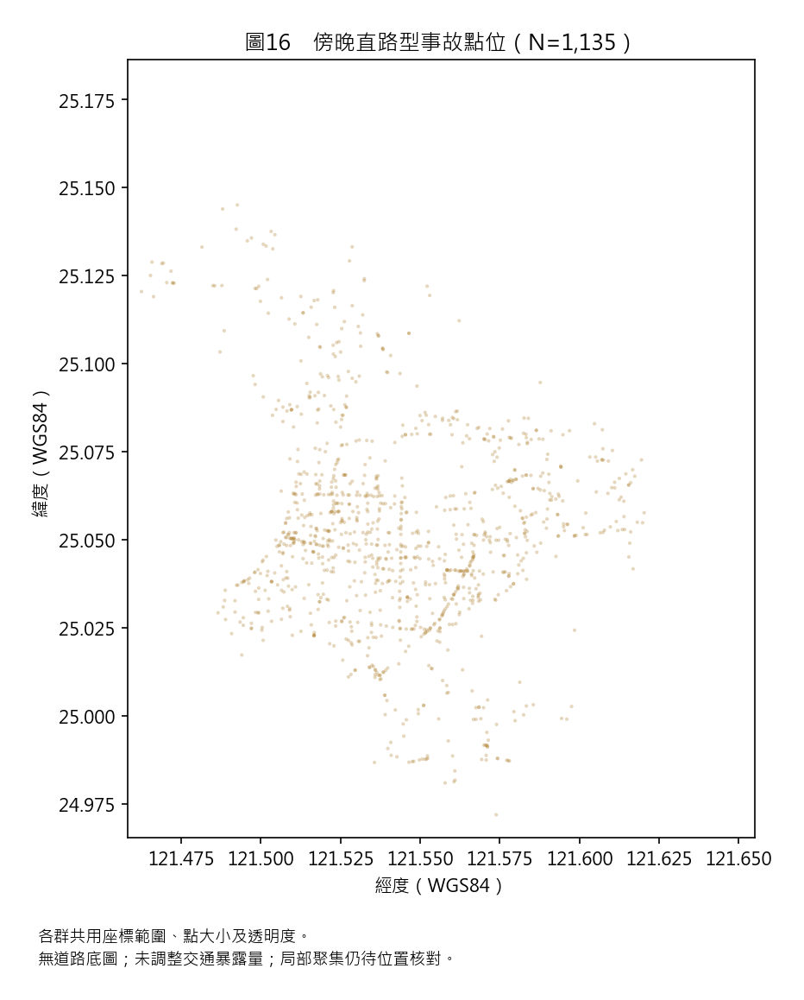

**圖17　傍晚交岔路型事故點位（N=1,854）**

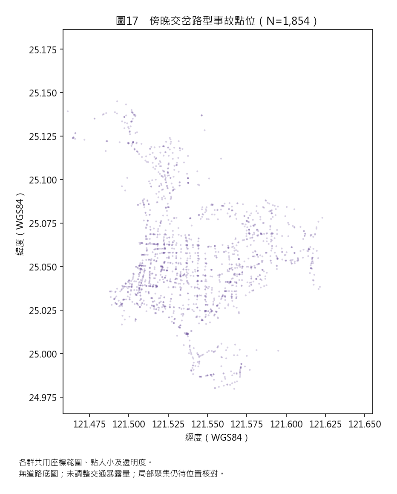

各群都廣泛分布於資料範圍，未呈現互相分離的地理區域。圖13～17是無道路底圖的WGS84座標散點圖，點位重疊與群組件數會影響視覺效果，尚不能辨識具體道路熱點，也不是空間聚集檢定。後續需結合道路位置核對與群內比例，避免把大群的點多誤解為風險高。

## 5. 如何根據初步結果深入探討？

後續分析應回答「哪些差異能跨設定維持」，再決定要深入哪些情境，而不是為每一群都提出不同政策。

**表9　已完成的初步比較與下一步**

| 目前證據／問題 | 已完成 | 下一步及其目的 |
| --- | --- | --- |
| 五群可細分道路，但跨權重一致度較低 | 含／不含月份、兩種矩陣、K=2～6、初始化穩定性及Ward抽樣比較 | **優先對照K=3、K=4、K=5的profile及照明結果，判斷哪些細分足夠穩定** |
| 天候在五群中差異有限 | 各群天候組成已檢視 | 比較保留／移除天候；若結果幾乎不變，可採較精簡輸入，將天候留作事後描述 |
| 凌晨型照明與死亡比例較突出 | 群組層級的照明、死亡與受傷比較 | 在樣本允許下，按主要道路型態或行政區分層，檢查是否只是道路與地區組成差異 |
| 傍晚直路與交岔路型有可解釋差異 | 兩群道路profile、照明及傷亡已比較 | 在相近時段與速限範圍內核對具體地點、事故位置與照明設備，形成現勘候選清單 |
| 行政區差異小，仍可能有局部聚集 | 各群行政區組成與共同尺度的獨立點位圖（圖13～17） | 補道路底圖及位置核對，區分群內局部聚集與單純樣本量差異 |
| 主分析排除速限0，PCA門檻亦會影響結果 | 固定主樣本與80%門檻的結果已完成 | 釐清速限0定義；比較70%／90%門檻、不降維及固定夜間子樣本下的分群 |

交叉分析先從「群組×照明」「群組×傷亡」「群組×行政區」開始，再對最有線索的情境分層。**不直接把群組、照明、死亡與12個行政區一次交叉切開**，因為全樣本死亡事故只有26件，細分後大量格子會沒有或只有一件，難以估計穩定比例。

目前較適合提出的應用是優先核對凌晨情境與傍晚不同道路型態的候選地點；尚不能建議以本次分群結果直接分配照明改善資源。

## 6. 期中結論與研究限制

本次分析已從「描述夜間事故分布」推進到「比較不同特徵設定能否形成可解釋情境」。移除月份後，道路型態在PCA中更突出，五群能辨識出凌晨、速限50晚間、低速限、傍晚直路及傍晚交岔路等情境。

目前最明確的結果是凌晨型的照明問題與死亡事故比例較高；受傷人數未顯示明顯差異，行政區與座標分布的整體區隔較弱。這些差異值得深入，但不等於已確認原因。

主要限制包括：

1. **群組尚未定案。** 三群較穩定，五群較細；五群結果對權重設定敏感，不能把單次分群當成天然事故類型。
2. **事故觀察單位與速限0定義待核對。** 第一當事人紀錄與候選鍵檢查不能完全取代官方事故識別碼。
3. **稀少死亡與重傷資訊不足。** 24小時死亡事故只有26件；受傷總人數不能代表傷勢程度。
4. **夜間與季節的取樣關係。** 日落日出定義會改變不同季節納入的時段；天文夜間也不等於現場亮度。
5. **缺乏交通暴露量與非事故道路。** 所有比例均在已發生事故內計算，不能稱事故發生率、全市道路風險或照明改善效果。

下一階段最重要的工作，是確認哪些道路與時段情境在不同群數、特徵與權重下仍然存在，再對穩定情境做照明、傷亡及地理的分層比較。

## 附錄：執行依據與可追溯資料

本稿數字與十七張獨立圖片（圖1～17）由2026-11-09的[執行Notebook](../finding/nighttime_no_month_midterm.ipynb)產生，已從乾淨Python kernel依序執行、保留輸出，並重現原本含月份的一般矩陣K=5（相對既有標籤ARI=1）。環境為Python 3.13.5、NumPy 2.1.3、pandas 2.2.3、scikit-learn 1.6.1。原始及既有處理資料未改寫。

輸入檔固定使用專案相對路徑及SHA-256。本地CRLF與既有LF紀錄的差異已核對為換行格式，未改變CSV內容；接受的精確版本、樣本與欄位檢查保留於Notebook及[輸入版本表](../finding/assets/nighttime_midterm/input_bindings.csv)。

| 用途 | 檔案 |
| --- | --- |
| 既有研究計畫與資料來源 | [研究計畫](taipei-nighttime-unlit-crash-proposal.md) |
| 主樣本定義與處理規則 | [分群資料說明](../data/processed/taipei_2025_nighttime_clustering_documentation.ipynb) |
| 含月份的原分析 | [PCA與分群比較](../finding/夜間事故PCA與分群比較.ipynb)、[原五群profile](../finding/夜間事故五群profile與照明比較.ipynb) |
| 本稿完整變數摘要 | [數值摘要](../finding/assets/nighttime_midterm/numeric_summary.csv)、[類別分布](../finding/assets/nighttime_midterm/category_summary.csv) |
| 群數與權重比較 | [K=2～6指標](../finding/assets/nighttime_midterm/k_comparison.csv)、[跨矩陣一致度](../finding/assets/nighttime_midterm/cross_matrix_agreement.csv) |
| 群組與分群後結果 | [群組profile](../finding/assets/nighttime_midterm/cluster_profile.csv)、[照明與傷亡](../finding/assets/nighttime_midterm/cluster_outcomes.csv)、[行政區](../finding/assets/nighttime_midterm/cluster_districts.csv) |
| 探索性檢定與季節群銜接 | [整體檢定](../finding/assets/nighttime_midterm/outcome_tests.csv)、[含／不含月份交叉件數](../finding/assets/nighttime_midterm/month_no_month_transition.csv) |

正式報告以本稿明列的6,701件與不含月份規格為準，引用舊敘述統計時須另註其樣本分母。未列為已完成的敏感度與分層分析，仍是後續工作。
